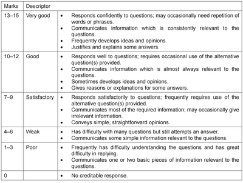
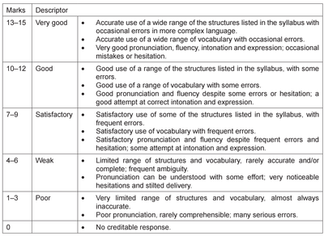

# Topic Conversations

* There are two topic conversations listed on the candidate card, and both will be tested. You will only get to know of the topics decided for you when you're taking the examination, as its not mentioned in the card.

* 15 marks go to communication, and 15 for quality of language. These marks are for both topics together. Each topic is ideally 4 minutes long.

  Communication is graded according to the following:

  

  Language quality is graded as follows:

  

* Responses should be longer and deeper for these conversations. More information and opinions should be given out.

* Minor mistakes are allowed, as long as they dont disturb the flow of the conversation or alter the meaning being delivered