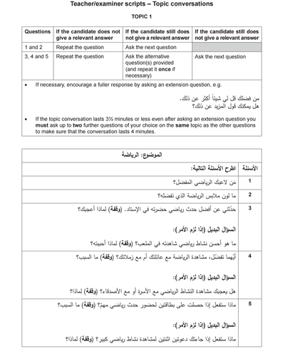

## Example 1

### Questions:

### Example Answers:

1. لاعبي المفضل هو ميسي ، فهو لاعب كرة قدم محترف، وأنا معجب بأداءه

2. أنا أفضل أن أرتدي اللون الابيض، فهو لون بسيط، لكننه يقيني من أشعة الشمس الحادة. لكن في بعض الاحيان قد أرتدي اللون الاصفر، فهو لون فريقي المفضل

3. أذكر أنني ذهبت لمشاهدة مبارة كأس العالم قبل سنتين، وقد كانت حماسية ورائعة جدا، وأذكر أن فريقي أحرز ثلاثة أهداف. كنا نشجع الفريق أثناء المباراة، وعندما احرزوا هدفا هتفنا جميعا. كانت مباراة مذهلة.

4. أفضل مشاهدة الرياضة مع أصدقائي، فنحن جميعا نحب كرة القدم وبعضنا يشجع نفس الفريق. أما عائلتي، فلا يحبون كرة القدم، فأختي تشاهد لعبة الجمباز، وأنا أعتقد انها لعبة مملة جدا

5. سأكون متحمسا جدا، وقد أذهب مع صديقي المفضل، فنحن نشجع نفس الفريق، وهو شخص حماسي جدا، ويعرف الكثير عن كرة القدم. وأذكر أنني وعدته بأن نذهب الى مباراة مهمة في يوم ما، فيجب علي أن أفي بالوعد.