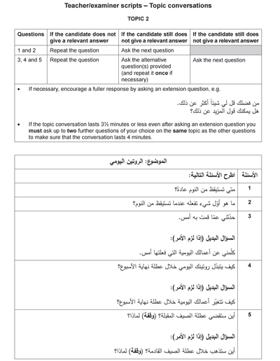

## Example 2

### Question:

### Example Answers:

1. أستيقظ الساعة السادسة والنصف كل يوم

2. عادة ما أبدا يومي بالذهاب الى الحمام، ثم أتوضأ وأصلي، ثم أرتدي ثيابي الرياضية  وأذهب الى صالة الرياضة لفترة قصيرة.

3. يوم أمس، أستيقظت باكرا، وذهبت الى صالة الرياضة، ثم تناولت الفطور. كان لدي محاضرة من الساعة التاسعة الى الساعة العاشرة والنصف فذهبت الى الجامعة بعد تناول الفطور.أثناء فترة الاستراحة، جلست في المقهى قليلا. كانت محاضرتي الثانية من الساعة الحادية عشرة والنصف حتى الساعة الواحدة ظهرا. بعدما أنتهيت من المحاضرة، ذهبت الى المسجد وصليت صلاة الظهر. كانت محاضرتي الثالثة من الثانية حتى الثالثة والنصف، لكنها كانت مملة قليلا.

4. أثناء عطلة نهاية الاسبوع، أنا لا أغير كثيرا في جدولي، فأنا أستيقظ في نفس الوقت تقريبا، وأذهب الى صالة الرياضة ككل يوم. لكن بدلا من أن أذهب الى الجامعة، أنا أبقى في البيت وأقرأ كتابا، ثم أدرس قليلا.

5. سأقضي عطلة الصيف في البيت، ولكنني سأكون مع عائلتي، وسألتقي مع أصدقائي من حين الى أخر. أود أن أكتشف مدينتي قليلا وان أتعرف على أماكن جديدة وعلى أناس جدد