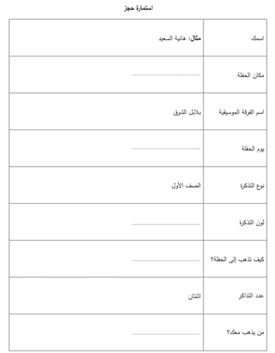

# Writing

## Question 1

* Fill in the appropriate response to the questions in the form

* This question is worth 5 marks

* Ideally spend 5 - 10 minutes to solve this

* Answers are often one word or a short phrase

* Try to get this question right

### Example Question

### Example Answers:

1. المسرح / القاعة / الفصل

2. الخميس / ٤ يناير

3. صفراء / حمراء

4. بالسيارة / مشيا على الاقدام

5. صديقتي / زميلي / والدي