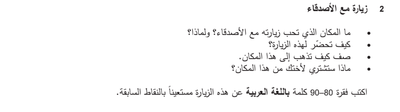

## Question 2

* You have to write about 80 -90 words

* The topic is usually an everyday topic

* Make a small mind map beside the questions to assist you with writing

* Use / Answer the points given

* The question is worth 12 marks

* Spend around 15 to 25 minutes to write your paragraph / text

### Question Example

### Points that can be included

1. الملاهي / السينما / الشاطئ، مكان ممتع / جميل / أحب المكان

2. أحضر معي ملابس (دافئة / سباحة) / أخذ بعض المال / أشتري معدات

3. نركب الحافلة / القطار / الطائرة / الباخرة، نأخذ سيارة / قارب، نذهب الى المحطة / المطار

4. لعبة / دمية / طعاما / تذكارا