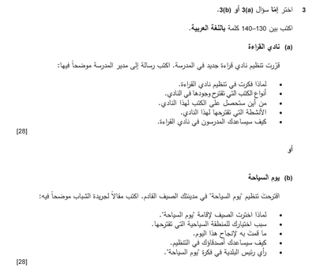

## Question 3

* You have to pick one of two topics

* Choose the topic that is easier for you (where you can put more points)

* Make a small mind map to collect your thoughts before writing

* You will have to write an email, letter, article, or blog that is 130 - 140 words long

* Spend about 25 - 30 minutes in this question

* Focus on the points mentioned in the question

### Question Example

### Points that can be included

A)

1. احب القراءة / يوجد الكثير من الطلاب الذين يحبون القراءة

2. كتب علمية / كتب محلية / مجلات وقصص / كتب قديمة 

3. المكتبة (الوطنية) / تبرعات (من الطلاب / الاساتذة / الاهل)

4. لقاء مع مؤلفي الكتب / قراءة جماعية / كتابة ملخصات

5. تشجيع الطلاب / مساهمات مالية / ارشاد اعضاء النادي / ادارة شؤون النادي

B)

1. لا يوجد مدرسة / الشباب عادة في البيت / الكثير من الناس قد يشاركوا

2. رمز بلدي / مكان مشهور / الدخول مجاني / المكان محافض عليه

3. ارسال خطابات / جمع المال او التبرعات / نشر الاعلانات / التعاون مع البلدة (المكان)

4. سيرسلون خطابات / يدعون زملائهم / يحضرون او يشترون المعدات / التحفيز

5. احب الفكرة / مستعد للمساعدة / دعم مالي / حجز المكان