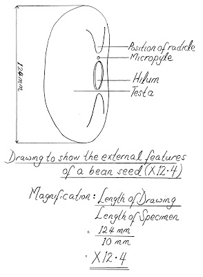

# Drawings

## Drawing Specimens

* Make sure you use a sharp pencil.
* Your outline is clear.
* The drawing should be as large as space provided.
* Ensure your drawing does not go over any printed matter, i.e. the question or the marks.
* It has definite outlines (no 'sketchy’ lines)
* No shading.
* No arrow heads when labelling
* Lines point exactly at the labelled part.

## 

## Labellings

* The label should point directly to the requested component/part.

* Ensure a ruler is used to draw a label line

* Make sure any diagrams fill the space given on the paper and are fully labelled.

* Details

  * Ensure you focus on details such as the number of body segments or the number of sections seen in the given image.
  * Make sure you draw the same number as in the given image.

* Proportions

  * Ensure that the image is enlarged proportionately means all the parts are increased in size proportionately and not only one of the parts.
  * For example: If an insect image is to be redrawn, make sure you increase all the 3 body parts along with the legs in size and not only the body parts.