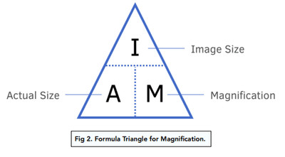

# Magnification

## Calculating Magnification

The standard formula: Magnification = Image Size / Actual Size

Image Size: How large the specimen appears in a diagram, photograph, or under a microscope.

Actual Size: The true size of the specimen in reality

**Conversions**

1. 1m = 100cm
2. 1cm = 10mm
3. 1mm = 1000µm

The unit of magnification must have an X…. before the value.

**Formulas**

* Magnification = image size / actual size

* Actual size = image size / magnification

* Image size = magnification x actual size