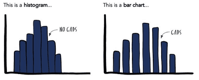

# Drawing Graphs

* Use a sharp pencil
* Label both axes (with the variable) including the units. For example, Temperature/°C and **a key** may be needed to indicate different plots
* Choose an even scale for each axis that uses up as much of the grid as possible.
  * Use the entire given grid.
  * The scale should be linear which means the difference between 2 numbers on an axis should remain constant. 
  * Your graph should occupy more than 50 % of the given grid on both planes.
* The independent variable is plotted on the x-axis
* The dependent variable (i.e. the one that changes due to a change of the other) is plotted on the y-axis.
* Join your plotted points with ruled lines
  * Even if a line of best fit is asked, join all points with ruled lines except the anomalous reading point. 
* When drawing bar charts, all bars must be of the same width
* The bars, when drawn cannot touch each other
* Use crosses “(×)” or “⊙” to mark the data points (for scatter graphs)

## Bar Charts and Histogram Charts 

