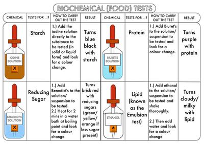

# Food Tests

* **Starch:** Add a few drops of iodine solution, +ve result = blue-black colour
* **Reducing Sugars:** Add Benedict’s reagent, and then the mixture is heated in a water bath for 2 to 3 minutes.
  * +ve result (increasing concentration of sugar) = blue → brick red
  * -ve result = remains blue
* **Proteins:** Add few drops of Biuret reagent, +ve result = purple/lilac color, -ve result = remains blue
* **Fats:** For the emulsion test, ethanol is added to the mixture and poured into a test tube with an equal amount of distilled water, +ve result = milky-white cloudy emulsion.
* **Vitamin C**: Add 1 cm3 of DCPIP solution and a small amount of food sample (as a solution) to a test tube. A positive test will show the blue colour of the dye disappearing. the blue dye, which turns pink in acid conditions, is reduced to a colorless compound. 