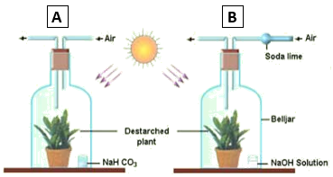

## Carbon Dioxide Is Necessary for Photosynthesis

- Take two destarched potted plants.

- Cover both the plants with bell jars and label them as A and B.

- Inside A, keep NaHCO­3 (sodium hydrogencarbonate).
  It produces CO2.

- Inside B, keep NaOH (Sodium hydroxide). It absorbs CO2.

- Keep both the set-ups in the sunlight for at least 6 hours.

- Perform the starch test on both of the plants.

- The leaves of Plant A will turn black after the starch test

- The leaves of Plant B will remain orange/brown after starch test

