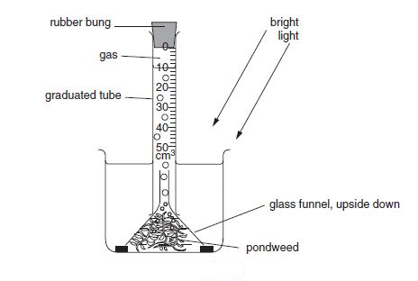

## Investigating what happens when varying the factors affecting photosynthesis

  - **Light intensity:** First a lamp is placed as close as possible to
    the apparatus, then the experiment is repeated several times, each
    times with the lamp further away from the apparatus. Heat from the
    bulb is prevented by placing a clear glass sheet between the lamp
    and the apparatus, and the pond weed used is left for several
    minutes in each new light intensity to allow it to adjust to new
    conditions before rate is measured.

  - **Carbon dioxide:** vary the amount of hydrogen carbonate in the
    solution, this supplies the plant with carbon dioxide for
    photosynthesis

  - **Temperature:** set up the apparatus in several
    different-temperature environments

