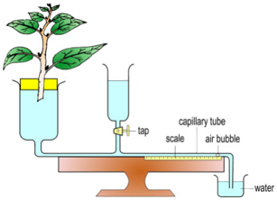

# Investigating Transpiration

  - Use a sharp razor blade to cut a leafy shoot under water.

  - Insert the leafy shoot through the hole of the stopper provided with
    the potometer.

  - Fill the potometer with water and fit the stopper holding the leafy
    shoot to the apparatus.

  - Trap an air bubble in the capillary tube by the following
    procedures:
    
      - dip the end of the capillary tube into a beaker of water,
    
      - close the tap of the reservoir,
    
      - take away beaker of water and allow the plant to transpire
    
      - re-immerse the capillary tube into the beaker of water again.

  - Estimate rate of transpiration by measuring distance moved by the
    air bubble per unit time.

