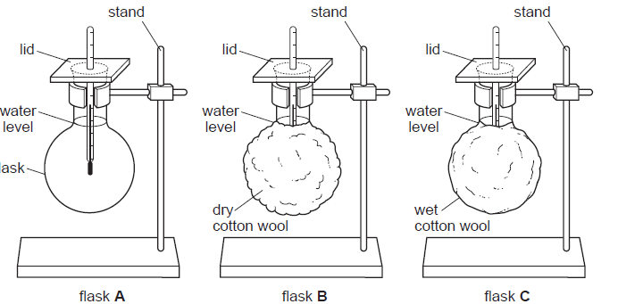

# Investigating Insulation

  - Flask A represents a hairless mammal, B represents a mammal with dry
    fur and C represents a mammal with wet fur

  - Equal amounts of hot water are added to the flask and temperature
    change after a set period of time is measured using a submerged
    thermometer.

  - Least temperature change means best insulated.
