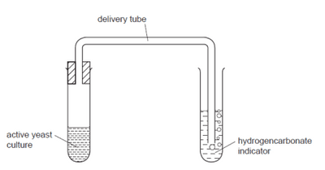

# Respiration

**Respiration**: the breakdown of nutrient molecules to release the energy between their bonds.

### **Aerobic Respiration**

* Chemical reactions in cells that use oxygen to break down nutrient molecules to release energy.
* Glucose + oxygen → carbon dioxide + water
* $\text{C}6 \text{H}_12 \text{O}_6 + \text{O}*2 \rightarrow \text{CO}_2 + \text{O}_2$

### **Anaerobic Respiration**

* Chemical reactions in cells that do not use oxygen to break down nutrient molecules to release energy. It releases much less energy per glucose molecule than aerobic respiration.
* In yeast: Glucose → carbon dioxide + ethanol
* $\text{C}6 \text{H}12\text{O}_6 + \text{O}_2 \rightarrow \text{CO}_2 + \text{H}_2$
* In muscles during vigorous exercise: Glucose → Lactic acid

### **Effect of Temperature on the Rate of Respiration**

As temperature increases, molecules gain more **kinetic energy**, moving faster and colliding successfully at a higher rate. Therefore, up to a certain point, as temperature increases, the rate of respiration increases. However, because respiration is an enzyme-catalysed reaction, the enzymes begin to denature at specific temperatures. Therefore, if the temperature increases drastically from optimum, the reaction rate will slow down, as the reaction can no longer be catalysed by enzymes properly.  