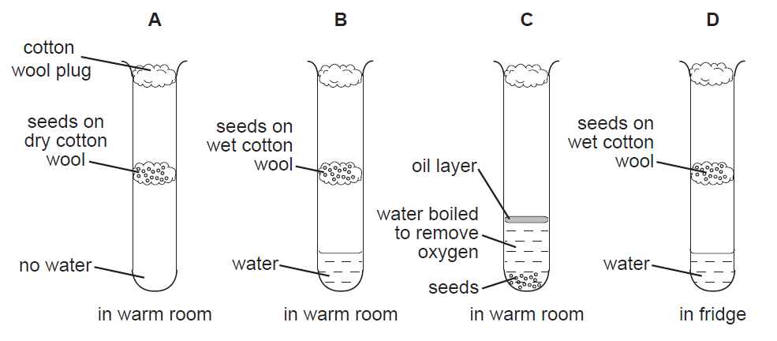

# Germination

* B will germinate fastest because it has access to water, and oxygen, and is at a warm temperature.
* A does not have access to water
* C does not have access to oxygen
* D has a very cold temperature even though all other factors are present

 