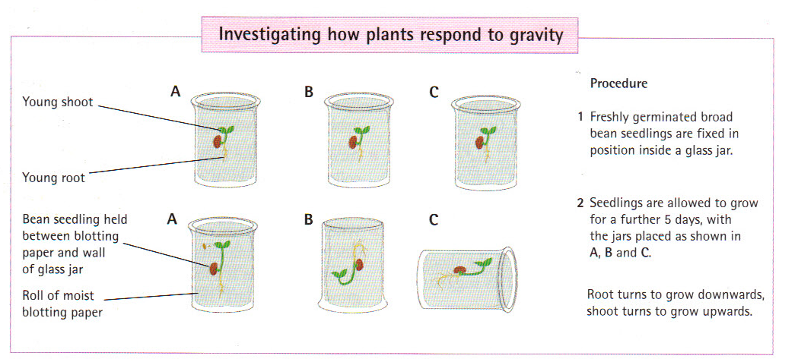

# Geotropism

  - Freshly germinate seedlings inside a glass jar, the seed is held by
    a roll of moist clotting paper.

  - Seedlings are allowed to grow for a further five days, with the jars
    placed a) the right way up b) upside down and c) on its side.

  - In each case the roots will turn to go downwards, and the shoot
    turns to grow upwards,

