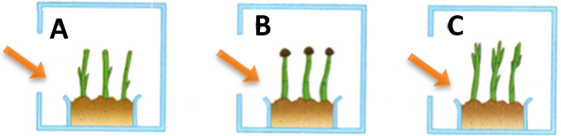

# Phototropism

  - There are three groups of oat shoots:
    
      - A) Has its tips removed, B) tips are covered and C) are
        untreated.

  - The coleoptiles are measured, and lengths recorded.

  - They are put in light proof boxes with one gap which only allow
    light to enter laterally

  - They are measured 2-3 days later, and new lengths are recorded.

  - Untreated coleoptiles will grow the most as they would bend towards
    the light

