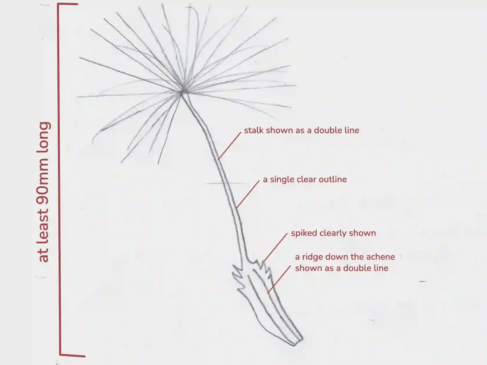

# 0610/62/O/N/24

## Question 1

a.

i)

|Test Tube|Time taken for the blue liquid to return to a green colour / s|Distance from the bright light / cm|
|:---|:---|:---|
|A|97|10|
|B|343|30|

ii) The rate of photosynthesis increases as light intensity increases.
iii) The time taken for the blue liquid to return to a green colour

iv) ***ERROR*** - Inaccurate endpoint of the colour change.
***IMPROVEMENT*** - Use a colorimeter to determine a consistent end point of the colour change

b.) Vitamin C

c.

i)

ii) length of PQ … **19 ± 1 mm**
actual length of the achene… **1.2 ± 0.1 mm**

d.) **similarity** - They both have an achene **or** They both have a parachute

**differences** - The dandelion has a stalk, but milk thistle does not. The dandelion’s achene has ridges, while the milk thistle’s achene is smooth. The milk thistle has more hairs than the dandelion

e.

i) yellow/brown

ii) Add Benedict’s Reagent to a solution containing the substance being tested. Heat the           solution for 2 minutes in a water bath, and inspect the solution for a colour change.

f.)

*(Write your variables in full sentences, not bullet points)*

**Independent Variables**

* The concentration of weedkiller

**Dependant Variables**

* The number of seeds germinated

**Constant Variables**

* The time that the seeds take to germinate

* The same type of soil in each plant pot

* The type of seed

* The room temperature that the seeds germinate in

* The volume of weedkiller used

**Method**

Prepare five solutions of weed killer at different concentrations—100%, 75%, 50%, 25%, and 0%—and label them A, B, C, D, and E respectively. Set up five small plant pots with the same labels and place five seeds in each pot. Spray each pot with its corresponding solution, then water the seeds and observe them over a period of two weeks. At the end of the two weeks, record how many seeds have germinated in each pot, counting germination only when the plumule or radicle is visible, and present your results in a table.

**Safety Precautions**

Wear gloves, goggles, and a mask