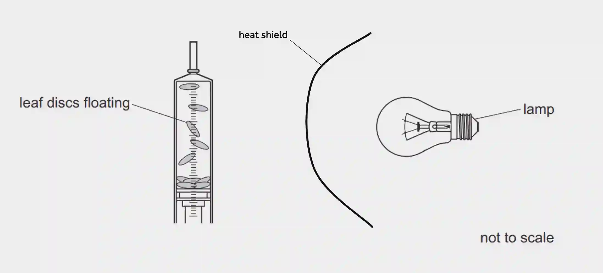
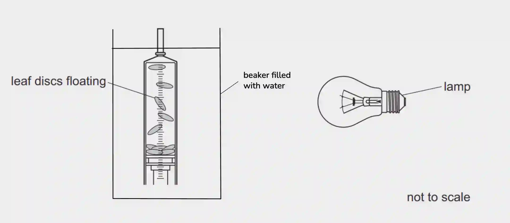
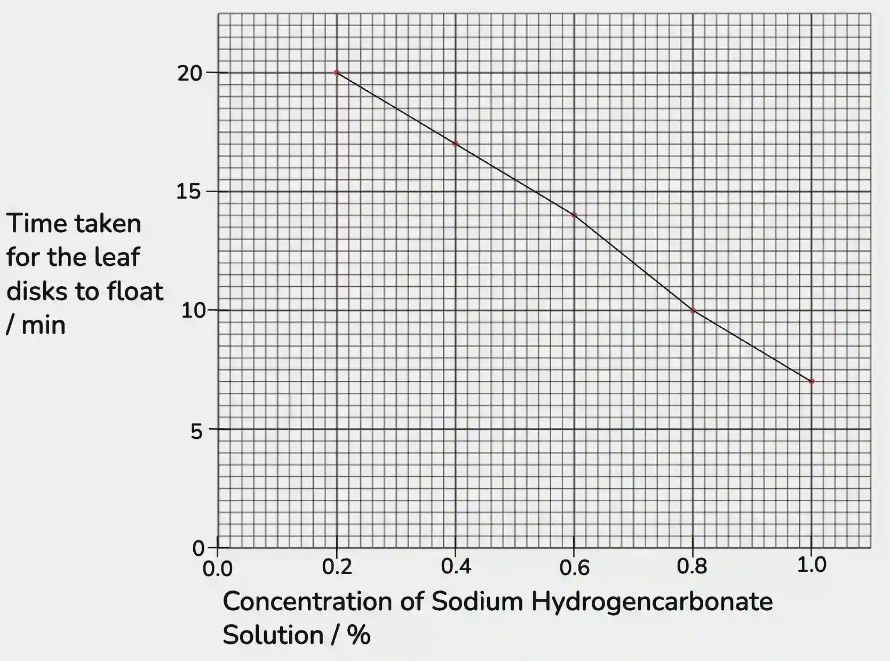
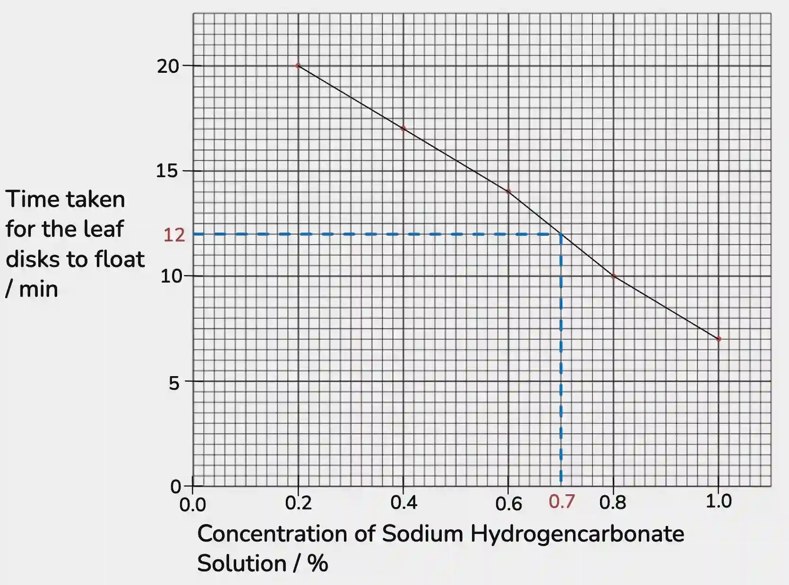

## Question 2

a.

i) **or** 

ii) The volume of sodium hydrogencarbonate solution used. The species of plant used for the experiment. The distance of the lamp from the syringe. The size of each disc.

iii) The concentration of sodium hydrogencarbonate solution.

b.

i) Draw a smooth line that passes through all points. The independent variable must be on x-axis.

ii)

iii) 20 - 17 = 3;
3/20 x 100 = **15%**