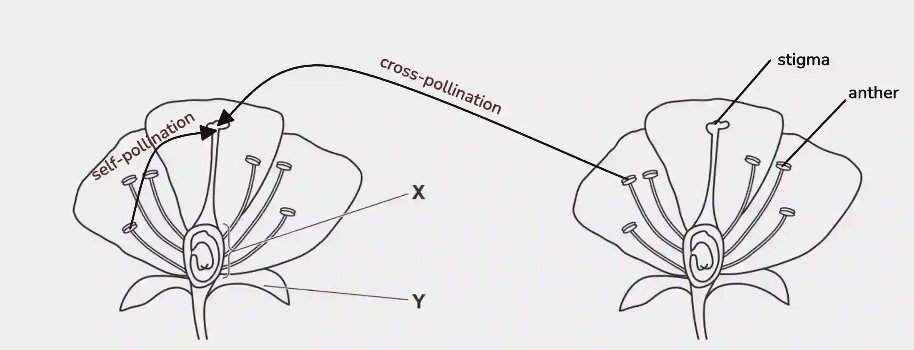

## Question 4

a. 

i) A species is a group of organisms that can reproduce with one another to produce fertile offspring

ii)

iii) X is the ovary, it contains the ovules, and fertilisation and seed formation takes place here. Y is the sepal, and it serves to protect the developing flower bud

b.) It still includes the use of haploid sex cells used to form a zygote, and the offspring still express genetic variation.

c.) Aquatic Environments