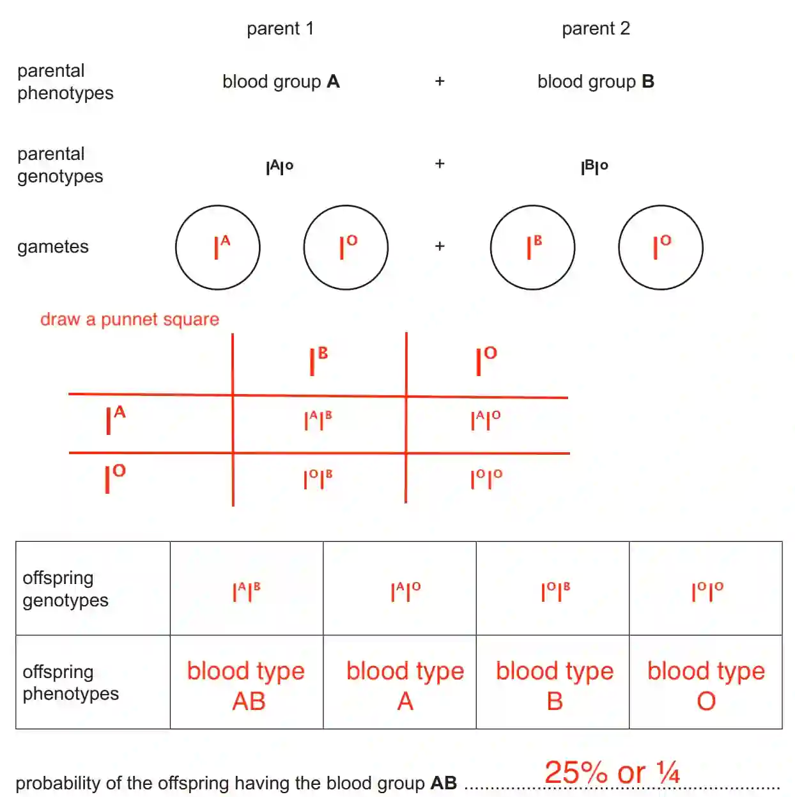

## Question 5

a.) 4 people with XY chromosomes

3 people with only Iᴬ allele

b.)Figure 5.1 shows that blood group is an example of discontinuous variation because there are only a few distinct blood groups phenotypes with no intermediates. It is also controlled by a single gene and not affected by the environment.

c.) flower colour, seed shape, seed colour, presence or absence of thorns, leaf shape

d.) When both alleles Iᴬ and Iᴮ are inherited together, they are both expressed equally in the phenotype. This results in blood group AB, where neither allele is dominant over the other, and both contribute to the blood group characteristics

e.)