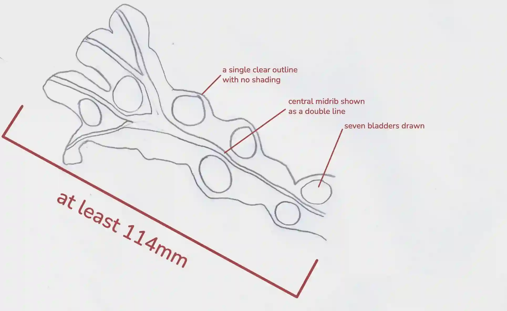
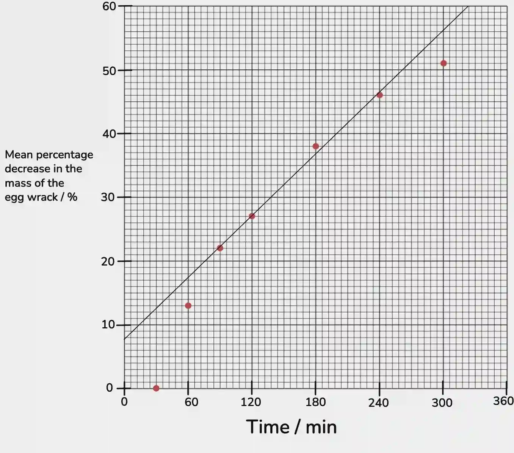

## Question 3

a.

i)

ii) 12 ± 1 mm

M = (12 ± 1) ÷ 19 = 0.63 ± 0.05

iii) The bladder wrack has more bladders. It’s bladders are closer together. The bladder wrack has a mid rib and divides into branches. The bladder wrack is wider and has rounded ends. The bladder wrack has a lighter in colour.

b.

i)temperature, wind(speed), humidity, seaweed species, size of the seaweed, **or** measuring time

ii)An anomalous result is a result that does not fit the pattern of the other data or is unexpected, possibly due to an error in the procedure or measurement.

iii) The students calculate the mean without the sample 2 results.

iv) 176 - 76 = 100

¹⁰⁰⁄₁₇₆ x 100 = **57%**

c.)

d.) Protein - Biuret Reagent

Vitamin C - DCPIP solution