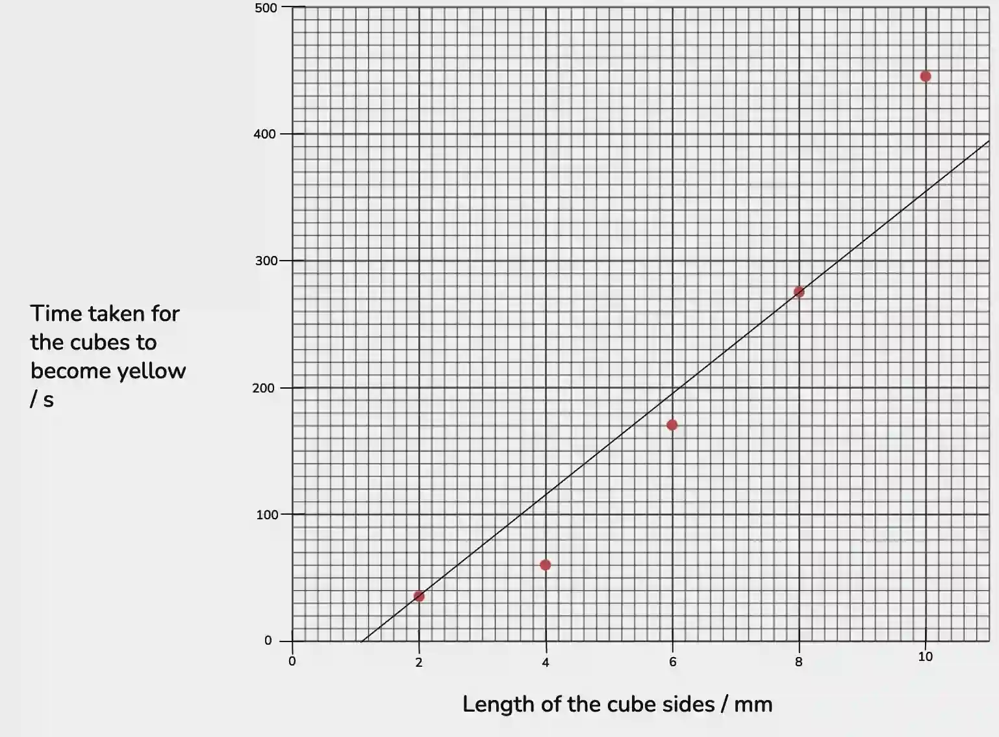
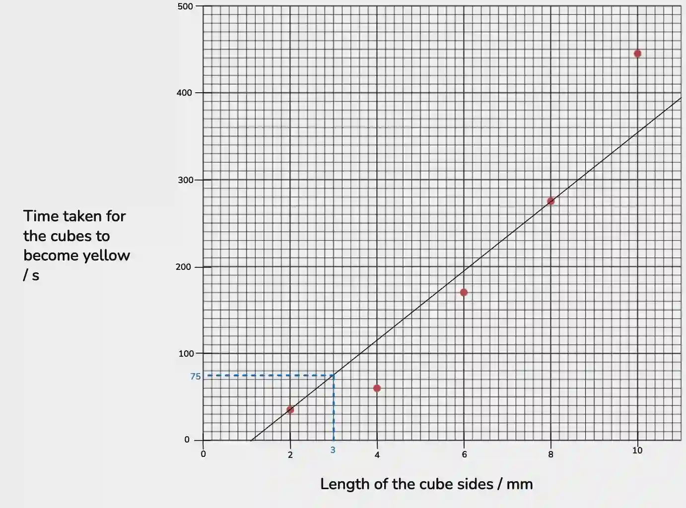

# 0610/62/M/J/24

## Question 1

a.

i)

#|
||

Beaker

|

final concentration of the hydrochloric acid solution / moldm⁻³

|

final volume of the solution / cm³

||
||

A1

|

1,00

|

20

||
||

A2

|

0,10

|

20

||
||

A3

|

0,01

|

20

||
|#

ii) - *measure the height of agar on the page with a ruler*

#|
||

Final Acid Concentration / moldm⁻³

|

Height of Yellow Agar / mm

||
||

1,00

|

25 (±1)

||
||

0,10

|

14 (±1)

||
||

0,01

|

5 (±1)

||
|#

iii) Increasing the concentration of hydrochloric acid increases the rate of diffusion.

iv) Independent Variable: Concentration of Hydrochloric Acid Solution

Dependent Variable: Height of Yellow Agar

v) 23°C

vi) Any change in temperature would affect all three test-tubes equally.

vii) Add only water to the agar jelly instead of acid.

viii) The height of the yellow agar in all 3 test tubes would increase.

b.

i)

#|
||

length of the cube sides/mm

|

volume of the cube/mm³

|

time taken for the cubes to become yellow/ s

||
||

2

|

8

|

35

||
||

4

|

4³ = 64

|

60

||
||

6

|

216

|

170

||
||

8

|

512

|

275

||
||

10

|

1000

|

445

||
|#

ii)

iii) 75 seconds

iv) **any 2 from:** temperature, concentration of acid, volume of acid, pH of acid, type of agar, density/solidity/concentration of agar, concentration of indicator, volume of indicator, type of indicator