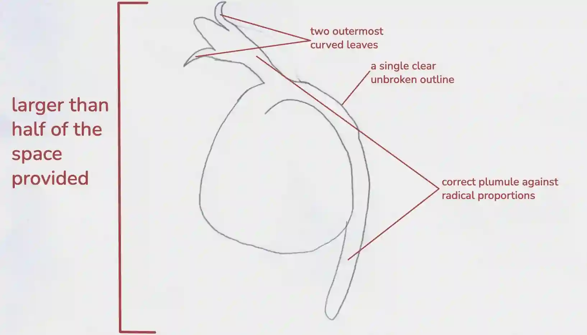

## Question 2

a.

i)

ii) length of line AB … **31 ± 1 mm**

magnification … 31/9 = **3.4x**

ii) **similarities:** They both have a root/radical, They both have a seed coat, They both have a structure pointing downwards, or They both have root hairs.

**differences:** P has a darker seed coat, P has a plumule/shoot/stem/stalk, P has thicker side roots, P has leaves, P is larger/longer, Q is hairy/fibrous, Q has thinner side roots.

b.) **starch:** Add iodine solution to a sample of the seedlings — a blue-black colour shows starch is present.

**reducing sugars:** Add Benedict’s solution and heat in a water bath — a green to brick-red precipitate shows reducing sugars are present.

c.)

*(Write your variables in full sentences, not bullet points)*

**Independent Variables**

* Light Intensity

**Dependant Variables**

* The angle of the seedling shoot measured from the horizontal.

**Constant Variables**

* Species and age of seedling

* Same soil type and pot size

* Same volume of water and watering schedule

**Method**

First, prepare three groups of identical pots labelled High, Medium, and Low, using the same type of soil in each pot and sowing five seeds per pot. Then, place identical lamps directly above each group and adjust their distances to create different light intensities, with the High group at 30 cm, the Medium group at 50 cm, and the Low group at 100 cm, while keeping the lamp type the same throughout. Next, maintain a fixed photoperiod and a consistent watering schedule for all groups, ensuring that the room temperature remains constant. After that, allow the seedlings to grow for seven days or until the shoots reach a predetermined height. At the end of the growth period, photograph each seedling from the side against a ruler or use a protractor to measure the angle between the soil surface (horizontal) and the main shoot, recording each individual angle in degrees. Finally, repeat the entire experiment at least two more times, calculate the mean angle for each light intensity, and compare the results.

**Safety Precautions**

Wear eye protection if using very bright lamps; secure lamps to prevent tipping and keep electrical leads away from water.