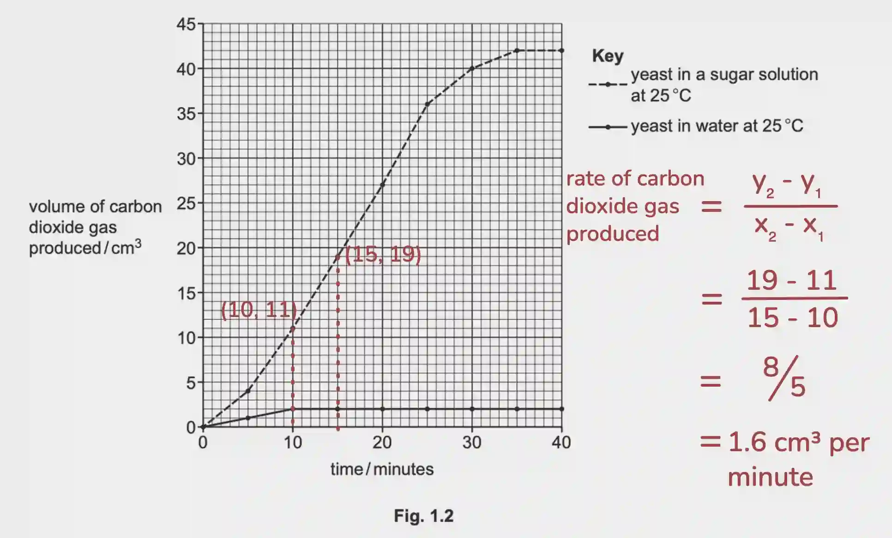

# 0610/42/M/J/24

## Question 1

a. 

i) The site of aerobic respiration

ii) They have cell walls made of cellulose, while fungi have cell walls made of chitin **or** Plants have chlorophyll/chloroplast, unlike fungi

b.) C₆H₁₂O₆ → 2C₂H₅OH + 2CO₂

c. 

i) 1.6cm³ per minute

ii) To prevent oxygen from entering the solution

iii) All of the sugar has been used up

iv) The enzyme has denatured, causing it’s active site to change shape. This causes the active site to no longer be complementary to it’s substrate, so the yeast cannot respire.

d.) Bread-making (leaving/making bread rise), or carbonating drinks.

e.) methane