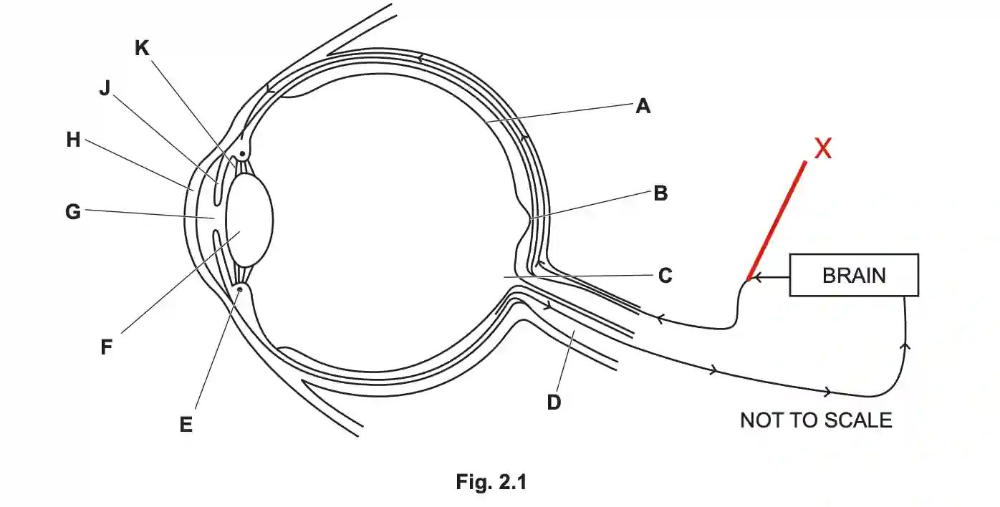

## Question 2

a.) A sense organ is a specialised organ made up of groups of receptor cells/tissue that detect specific stimuli (e.g. light, sound, chemicals, pressure, temperature) from the environment and transmit information as nerve impulses to the brain.

b. 

i)

ii)At a synapse, neurotransmitter molecules are released from vesicles in the presynaptic neurone into the synaptic cleft. These neurotransmitters then diffuse across the gap and bind to specific receptor proteins on the membrane of the postsynaptic neurone.

iii)When viewing a near object, the ciliary muscle (E) contracts. This reduces the tension on the suspensory ligaments (K), causing them to slacken. As a result, the lens (F) becomes thicker and more convex. This increases the refraction of light rays so that the image is focussed onto the retina (A or B), allowing a clear image of the near object to be formed.

c.)**any 4 from:** **(1)** Both rods and cones are light receptor cells found in the retina (A). **(2)** Cones are concentrated in the fovea (B) where there are no rods, **(3)** while neither rods nor cones are present in the blind spot (C). **(4)** Rods detect dim light, allowing night vision, but only produce black-and-white images. **(5)** Cones function in bright light and detect different wavelengths, giving colour vision.

d. 

i) allele

ii) XᵃY