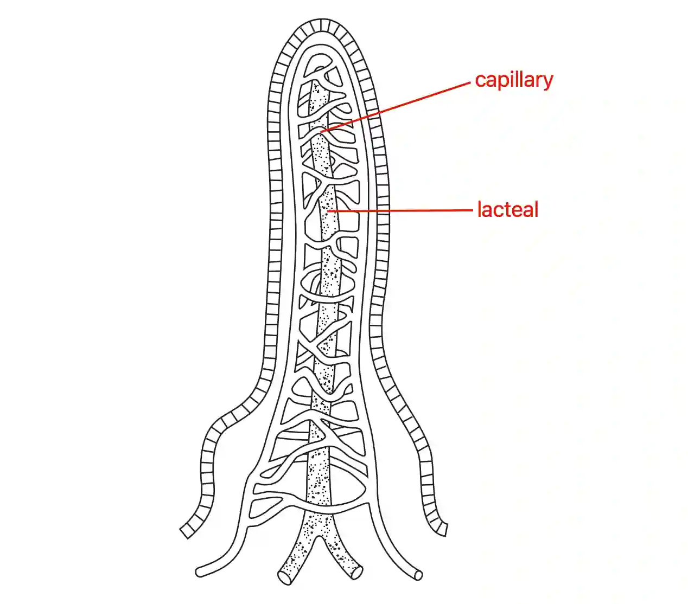

## Question 6

a.) The process of taking food into the mouth is called **ingestion**. Flat sharp‑edged teeth at the front of the mouth, called **incisors**, are used for biting off pieces of food. The **molars and premolars** are the large teeth towards the back of the mouth that are used for **chewing** the food.

b. 

i)

ii) The small intestine.

iii) The absorption and transportation of fatty acids/glycerol/fats/lipids.

c.) Amino acids move into the capillaries in the villus. They are then carried in the blood plasma and travel to the hepatic portal vein.