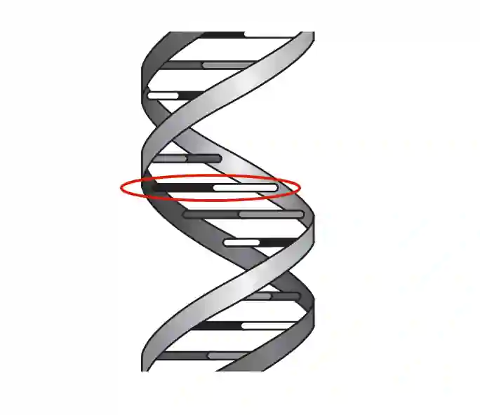

## Question 2

a.)

b.)100 - (29 x 2) = 42;
42 ÷ 2 = **21%**

c. 

i) a gene

ii) **any five from: (1)** Ribosomes make proteins/polypeptides. **(2)** mRNA is copied from a gene on DNA in the nucleus, **(3)** and then moves to the cytoplasm. **(4)** Once in the cytoplasm, the mRNA passes through a ribosome, **(5)** which assembles amino acids by translating the mRNA into a protein. **(6)** Protein synthesis requires energy, **(7)** and the order of amino acids is determined by the base sequence of the mRNA.

iii) Carrier proteins, Receptor proteins, **OR** Enzymes