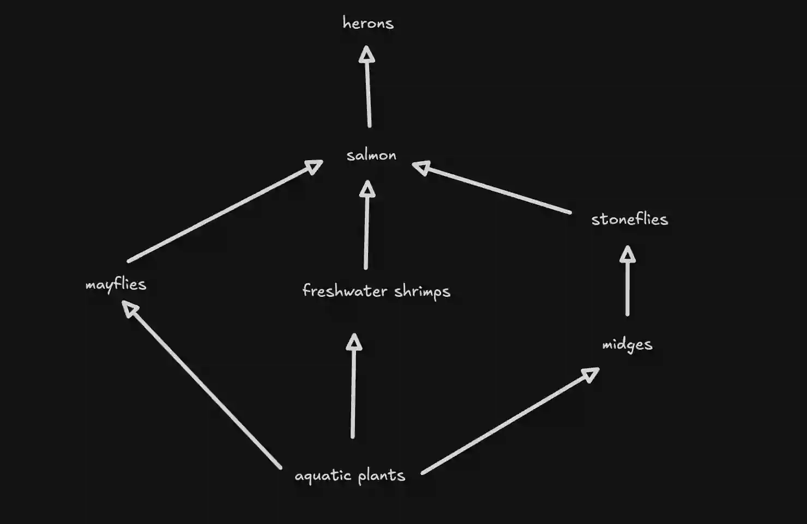

## Question 4

a. 

i)

ii)

|Name of Trophic Level|Organism|
|:---|:---|
|Producer|Aquatic Plants|
|Primary Consumer|Midges, Freshwater Shrimps, **or** Mayflies|
|Secondary Consumer|Stoneflies **or** Salmons|
|Tertiary Consumer|Salmons|
|Quaternary Consumer|Herons|

iii) **any three from: (1)** Primary consumers contain chemical energy. **(2)** This energy is transferred to secondary consumers when the primary consumers are eaten. **(3)** The food particles of the primary consumers are digested, making energy and glucose available for respiration. **(4)** The energy released is then used for growth. **(5)** Additionally, energy is used for protein synthesis/reproduction/assimilation/storage contributing to the biomass of the secondary consumers.

iv) This would lead to fewer herons. It would also increase the number of mayflies, stoneflies, and shrimps. The increase in the number of stoneflies, would lead to fewer midges. Additionally, there would be fewer aquatic plants.

b.) An organism that gains energy from dead/waste material.

c.) **any four from: (1)** It is more energy efficient for humans to eat crop plants because they are at a lower trophic level. **(2)** Less energy is available at higher trophic levels. **(3)** Energy transfer along a food chain is inefficient, as a significant amount of energy is lost through metabolic processes such as movement and muscle contraction. **(4)** In longer food chains, more material is also lost as faeces or other inedible and indigestible parts. **(5)** Additionally, energy is lost through excretion.