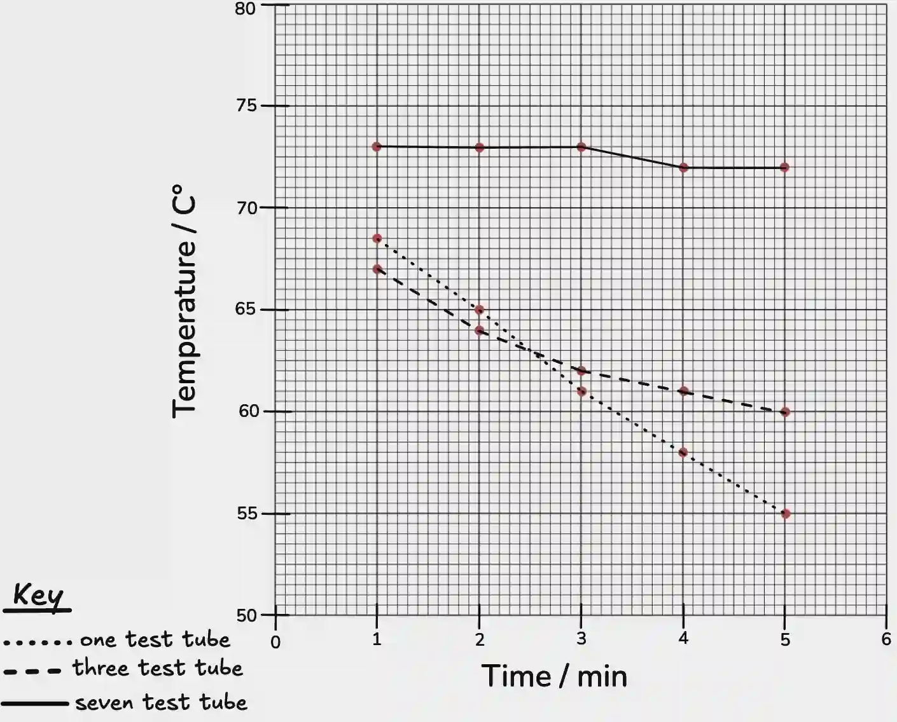

# 0610/62/M/J/23

## Question 1

a.

i) 68.5°C

ii)

|Time / min|Temperature / °C (one test-tube)|Temperature / °C (three test-tubes)|Temperature / °C (seven test-tubes)|
|:---|:---|:---|:---|
|1|68.5|67|73|
|2|65|64|73|
|3|61|62|73|
|4|58|61|72|
|5|55|60|72|

iii)

iv) Huddling of more test tubes reduces heat loss and conserves more heat **OR** The greater the number of test-tubes, the slower the temperature drops and the less heat is lost **OR** As time increases the temperature falls.

v) **Any two from:** Size of the test-tube **OR** Type/Thickness of test-tube **OR** The total experiment time **OR** The size of the time intervals **OR** All test-tubes must be placed in the beaker

vi) **Any two from:** Inconsistent volume of water used. The temperature of water is not measured at the start of the experiment. There is no elastic band on the single test-tube, so there is no insulating effect from the band on the single test-tube. The temperature of the environment may differ. The tightness of the band on the 3 test-tubes may differ from the tightness of the band on the 7 test-tubes.

vii) Repeat the experiment at least twice **OR** Use the same volume of water **OR** Put a band around the single test-tube **OR** Monitor the temperature of the room.

viii) Hot equipment/water **OR** The breakage of glass.

b.

**1. FORMATION OF REDUCING SUGARS METHOD**

*(Write your variables in full sentences, not bullet points)*

### **Independent Variable**

* Temperature of the amylase–starch mixture (°C)

### **Dependent Variable**

* Time for the starch to be completely hydrolysed in minutes

### **Constant Variables**

* pH of the reaction (pH 7).

* Concentration of starch solution.

* Concentration and volume of amylase used.

* Total reaction volume.

* Time intervals between taking samples.

### **Method**

First, prepare a 1% starch solution, a 1% amylase solution, and a pH 7 buffer. Then, label a set of test tubes for each temperature to be tested: 0, 10, 20, 30, 37, 45, and 60 °C. Next, add 2 cm³ of the starch solution and 1 cm³ of the buffer to one test tube, and place 1 cm³ of the amylase solution into a separate test tube. After that, place both test tubes into a water bath set to the required temperature and leave them for five minutes to allow the solutions to equilibrate. Once equilibrium has been reached, mix the contents of the two test tubes to start the reaction and begin timing immediately, ensuring that the reaction mixture remains at the same temperature using the water bath. Every 30 seconds, remove 1 cm³ of the reaction mixture using a pipette and add it to 2 cm³ of Benedict’s solution in a clean boiling tube. Then, heat the mixture in a boiling water bath for two minutes before allowing it to cool. After that, measure the amount reducing sugar produced using a colorimeter, a colour chart, or by weighing the precipitate. Finally, repeat the experiment twice more.

### Safety Precautions

Wear gloves and googles. Use a test-tube holder/tongs.

**2. DISAPPEARANCE OF STARCH**

*(Write your variables in full sentences, not bullet points)*

### **Independent Variable**

Temperature of the amylase–starch mixture (°C).

### **Dependent Variable**

Time for the starch to disappear (time until iodine stays orange/brown), measured in minutes.

### **Constant Variables**

* pH of the reaction (pH 7, buffer).

* Concentration of starch solution.

* Concentration and volume of amylase used.

* Total reaction volume.

* Volume of sample taken for testing.

* Time intervals between taking samples.

* Same iodine solution.

### **Method**

First, prepare a 1% starch solution, a 1% amylase solution, and a pH 7 buffer, and label test tubes for each temperature to be tested: 0, 10, 20, 30, 37, 45, and 60 °C. Then, add 2 cm³ of starch solution and 1 cm³ of buffer to one test tube, and 1 cm³ of amylase solution to another, placing both tubes in a water bath until they reach the required temperature. Next, mix the solutions to start the reaction and begin timing immediately, maintaining the temperature with the water bath. Every 30 seconds, remove a drop of the reaction mixture and place it onto a spotting tile containing a drop of iodine solution, observing the colour change: blue–black indicates starch is still present, while orange–brown indicates starch has been broken down. Record the time at which the iodine test first remains orange–brown, marking the end-point for that trial. Finally, repeat the experiment three times for each temperature.

### **Safety Precautions**

* Wear gloves and goggles when handling iodine solution.

* Use a test-tube holder when working with hot water baths.