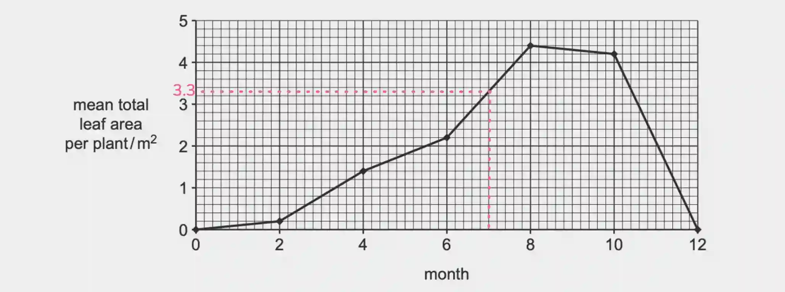
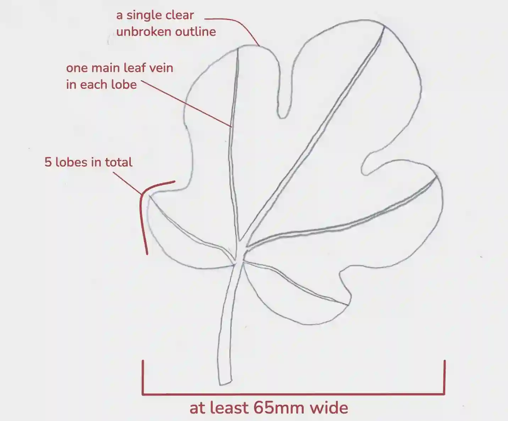

## Question 2

a.

i) To avoid bias, to increase reliability, **or** to identify/exclude anomalies.

ii) 3.3m²

iii) month four - 1.4m²; month 6 - 2.2m²; 100(2.2 ÷ 1.4) - 100% = **57%**

b.) 59cm² (within 55 - 66)

c.)Add the sample solution to Benedict’s solution and heat in a boiling water bath for about 2 minutes. A positive test is shown by a colour change from blue to green, yellow, or brick-red precipitate, depending on the amount of reducing sugar present.

d.) 

e.)

|Similarities|Differences|
|:---|:---|
|They both have veins|The fig leaf has a smooth/wavy edge, while the grapevine leaf has a serrated edge|
|They both are lobed|The fig leaf has a stalk, while the grapevine leaf has no leaf|
|They both have 5 lobes|The fig leaf has more veins|
|They both have branching veins||
