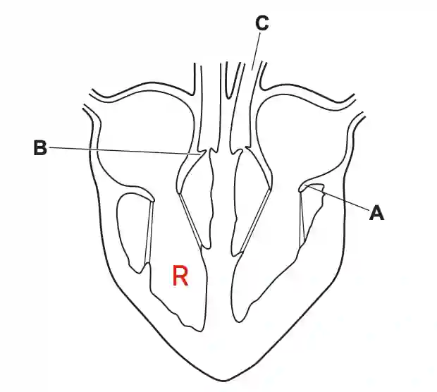

## Question 2

a. 

i)

ii) **A** - atrioventricular valve; **B** - semilunar valve

iii) Blood vessel C transports blood from the **left ventricle** to the **rest of the body**.

b.) A hole in the septum, where the left atrium is joined to the right atrium, allows oxygenated blood to mix with deoxygenated blood. This means that the blood transported or supplied to the respiring tissues will have a lower oxygen partial pressure, reducing the efficiency of oxygen delivery and potentially limiting aerobic respiration in the body.

c. 

i) **Any four from: (1)** Fig. 2.3 shows that the percentage of energy released from aerobic respiration increases and then remains constant. **(2)** Energy from aerobic respiration plateaus at 80% at 100 s. **(3)** Meanwhile, the percentage of energy released from anaerobic respiration increases, decreases and then remains constant, **(4)** with energy from anaerobic respiration peaking at 80% at 20 s and **(5)** later plateauing at 20% at 100 s. Overall, **(6)** energy from aerobic respiration increases gradually and energy from anaerobic respiration increases rapidly, and **(7)** energy from both aerobic and anaerobic respiration reaches 50% at 60 s.

ii)C₆H₁₂O₆ + 6O₂ → 6CO₂ + 6H₂O

iii) lactic acid