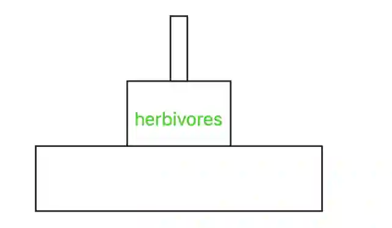

## Question 6

a. 

i) Phytoplankton are producers, so they photosynthesise; using up carbon dioxide to produce carbohydrates.

ii) Decomposer

iii) Aerobic Respiration, Combustion of fuels **OR** Decomposition of organic matter

iv) **Any three from: (1)** Carbon dioxide is a greenhouse gas, which traps heat in the atmosphere. This results in **(2 - any example will suffice)** climate change, and an enhanced greenhouse effect. As a result, there are **(3)** rising sea levels and **(4)** more frequent extreme weather events.

b. 

i)

ii) **(1)** Energy is lost between each trophic level as **(2 - any example of lost energy will suffice)** heat during respiration. Because of this energy loss, there is **(3)** insufficient energy to support more than five trophic levels.

iii) **(1)** A pyramid of energy shows the actual energy transfer between trophic levels. **(2)** It takes time into account **(3)** It is more accurate than a pyramid of biomass.

c. 

i) A resource that does not run out, because it is produced as quickly as it is used up.

ii) **(1 - choose one of these methods)** Fishing can be managed by implementing closed seasons/protected areas/quotas/education/smaller nets/larger mesh sizes/monitoring and legislation. **(2)** These measures prevent extinction of fish species, by preventing overfishing and therefore allowing fish to breed.