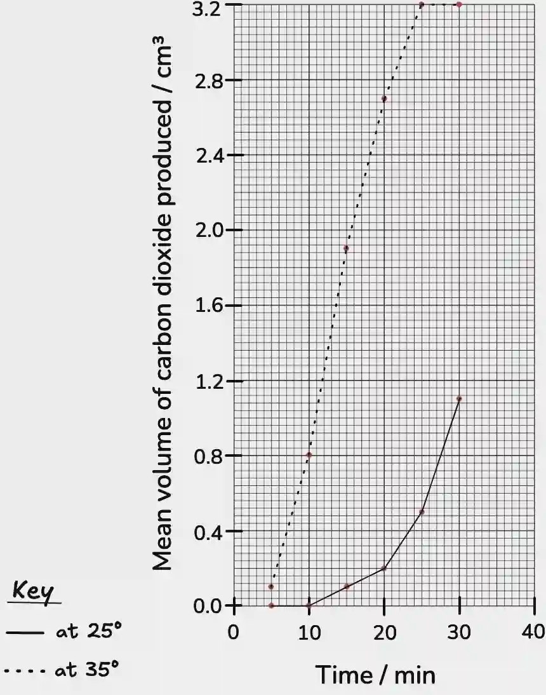
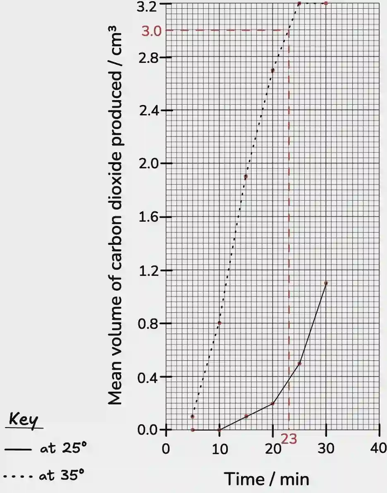

# 0610/62/F/M/24

## Question 1

a. 

i)

|Glucose concentration (%)|Time for blue to disappear / s|
|:---|:---|
|0.0|>600|
|0.5|302|
|1.0|192|

ii) There is a greater rate of respiration at a higher glucose concentration.

iii) The concentration of glucose.

iv) Temperature, Volume of yeast suspension, Volume of glucose and water solution, Concentration of methylene blue, Volume of methylene blue, Volume of oil layer, Time for equilibration in water bath before adding dye, Type of yeast suspension used, **OR** Type of oil.

v) To evenly disperse the yeast cells in the solution.

b. 

i) **any two from:** Repeat the experiment for each concentration, Use a standardised colour chart to identify the end point, Clean the glass rod between each use, **OR** Measure the times for different concentrations individually.

ii) Add 2.5cm³ of 0.50% glucose solution to 2.5cm³ of water to produce 5.0cm³ of 0.25% glucose solution

iii) Add the sample solution to Benedict’s solution and heat in a boiling water bath for about 2 minutes.

c. 

i) A gas syringe or an inverted measuring cylinder filled with water to collect and measure the volume of carbon dioxide produced.

ii) A result that deviates from the established pattern.

iii) They calculated the mean using their results, excluding the anomalous result. (1.8 + 2.0) / 2 = **1.9**

iv) **any two from: (1)** The mean volume of carbon dioxide at both temperatures increases overall, **(2)** but the mean volume is higher at 35°C. **(3)** At 35°C the volume of carbon dioxide becomes constant towards the end of the experiment, whereas at 25°C the mean volume continues to increase. **(4)** At 25°C no carbon dioxide is produced at the start.

v)

vi) 23 minutes

d.) From red to orange/yellow