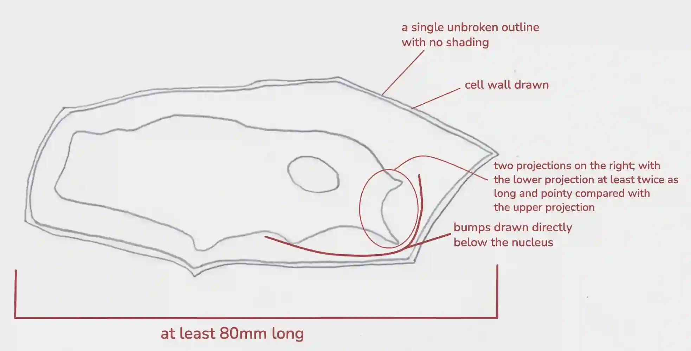

## Question 2

a.

i)

ii) **The length of PQ:** is 77mm

**The actual length of cell X is:** length of line PQ ÷ magnification

77 ÷ 340 = **0.226mm**

b.)

*(Write your variables in full sentences, not bullet points)*

### **Independent Variable**

* Concentration of sodium chloride (NaCl) solution

### **Dependent Variable**

* Change in mass of plant tissue

### **Constant Variables**

* Type and source of plant tissue

* Size and shape of samples

* Volume of solution per sample

* Temperature (carry out all trials at the same room temperature)

* Time immersed in solution.

### **Method**

First, prepare 50 cm³ sodium chloride solutions at concentrations of 0%, 0.5%, 1.0%, 2.0%, 4.0%, and 10% using distilled water, and label each container clearly. Then, cut two cylindrical potato pieces for each concentration, each measuring 10 mm in diameter and 30 mm in length, with an initial mass of approximately 1.0 g ± 0.05 g, gently blot them dry, and record their initial masses. Next, fully submerge the potato pieces in their corresponding sodium chloride solutions and leave them at room temperature (approximately 25 °C) for 20 minutes, ensuring they remain submerged if they float by using a small glass rod or weight. After this period, remove the potato pieces, surface-dry them using a consistent blotting method, and record their final masses to the nearest 0.01 g. Finally, repeat the experiment two more times.

### Safety Precautions

* Wear safety goggles and gloves when preparing and handling solutions.

* Cut plant tissue with care; use a cutting board and keep fingers away from blades.

* Clean up spills immediately and dispose of used salt solutions down the sink with plenty of water (or follow your institution’s waste rules).

* Wash hands after the experiment.