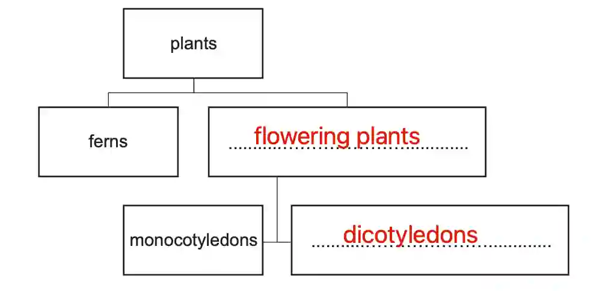
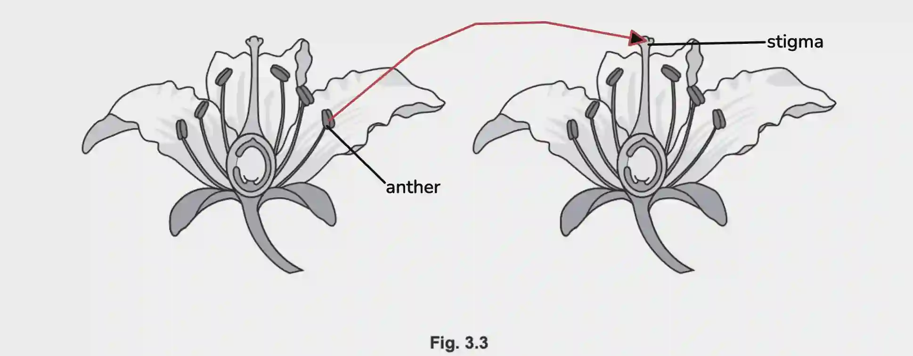
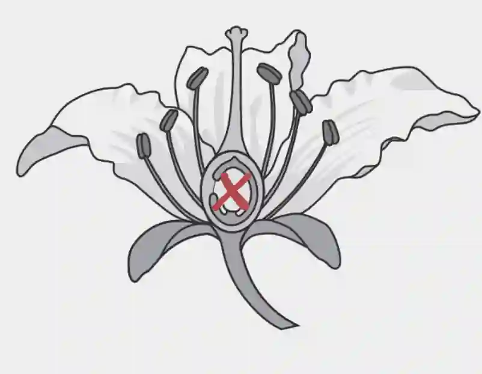

## Question 3

a. 

i)

ii) **any two from: (1)** A single cotyledon, **(2)** Parallel leaves, **(3)** Petals in multiples of three, **(4)** Fibrous roots

b. 

i) 1200/2 = **600 chromosomes**

ii) **any three from: (1)** Process A is meiosis, **(2)** a reduction division, producing haploid spores with a single set of chromosomes. These spores are **(3)** genetically different and are **(4)** dispersed by wind.

iii) Fertilisation

c. 

i) A group of organisms that can reproduce to produce fertile offspring

ii)

iii)

iv) **any three from: (1)** Cross pollination is dependant on pollinators, **(2)** it also requires more pollen to be produced to account for **(3)** the lower likelihood of fertilisation, as cross-pollination **(4)** requires more than one plant. **(5)** This leads to wastage of pollen, and **(6)** requires more energy.