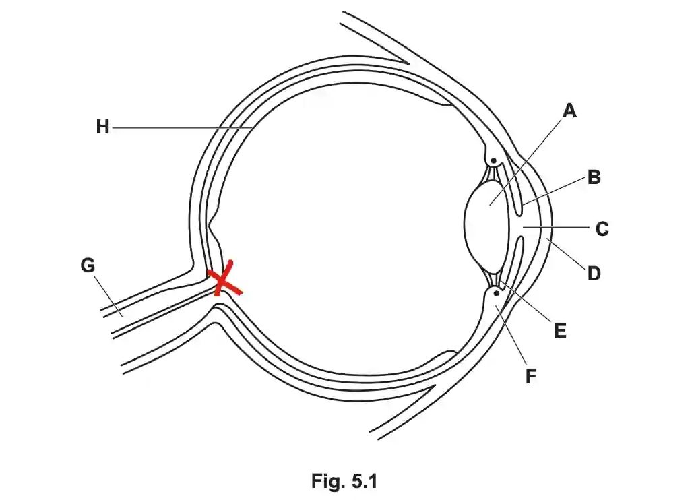

## Question 5

a.) The eye contains receptor cells that respond to light stimulus.

b.) The brain & The spinal cord

c. 

i)

ii)

|Name of the part|Letter in Fig. 5.1|Function|
|:---|:---|:---|
|Retina|H|Contains receptor cells; rods and cones|
|Optic Nerve|G|Transmits impulses to the central nervous system|
|Cornea|D|Refracts light, allowing it to enter the eye|

d.) **Circular muscles** and **Radial muscles**

e.) **any three from:** Because the suspensory ligaments are permanently overstretched, **(1)** the ciliary muscles are relaxed, and **(2)** the suspensory ligaments can no longer become taut. This causes **(3)** the lens to remain wide and unstretched. Because of this **(4)** the angle of refraction does not change to allow the eye to focus on distant objects.