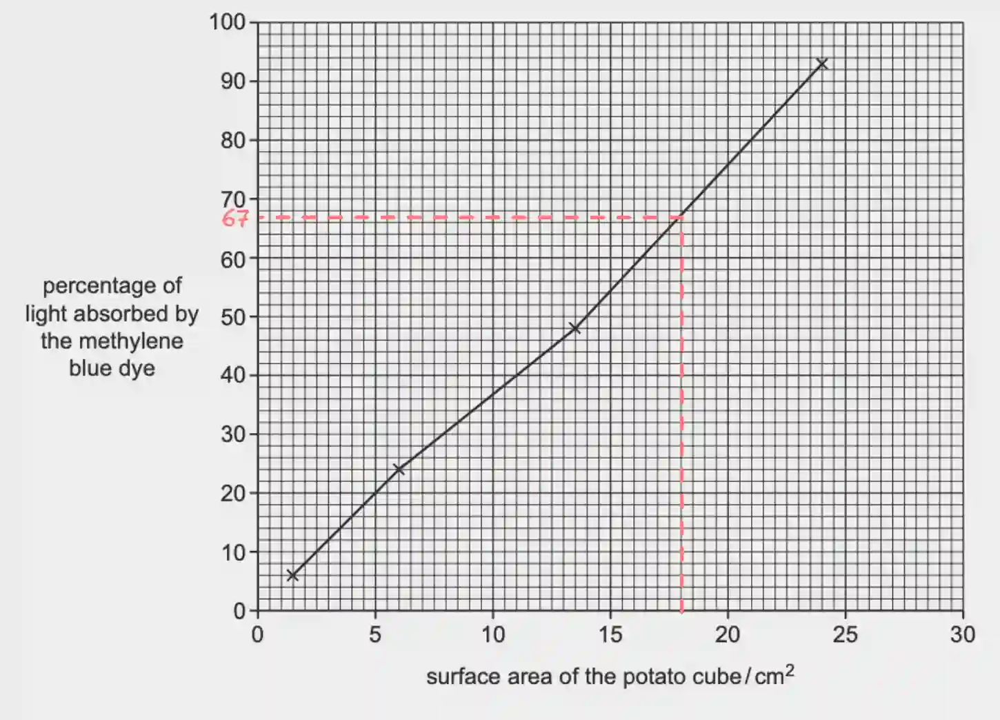

# 0610/62/F/M/23

## Question 1

a. 

i) **step 2** - 61°C; **step 11** - 38°C

ii)

|Test-tube|Temperature of water (°C)|Intensity of blue colour|
|:---|:---|:---|
|C|cold|pale|
|W|warm|medium|
|H|hot|dark|

iii) As the temperature increases, the rate of diffusion increases

iv) The difference in the volume or concentration of dye **OR** The difference in the size of the potato cylinders

v) The sharp scalpel used to cut the potato cylinders **OR** The risk of burning yourself with the hot water

vi) Use a thermostatically controlled water bath to maintain a constant temperature.

vii) Collecting several results increases accuracy by allowing anomalous results to be identified.

b. 

i) **independent variable -** the size of the potato cubes; **dependent variable -** the percentage of light absorbed

ii) The type of dye used **OR** The time that each potato cube is soaked in the dye solution.

iii) 67%

