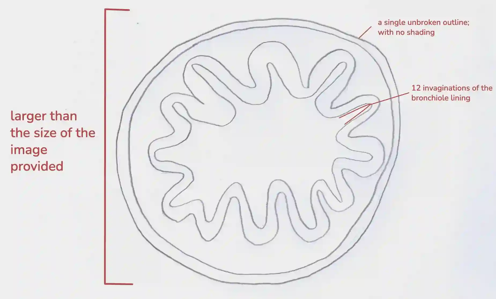
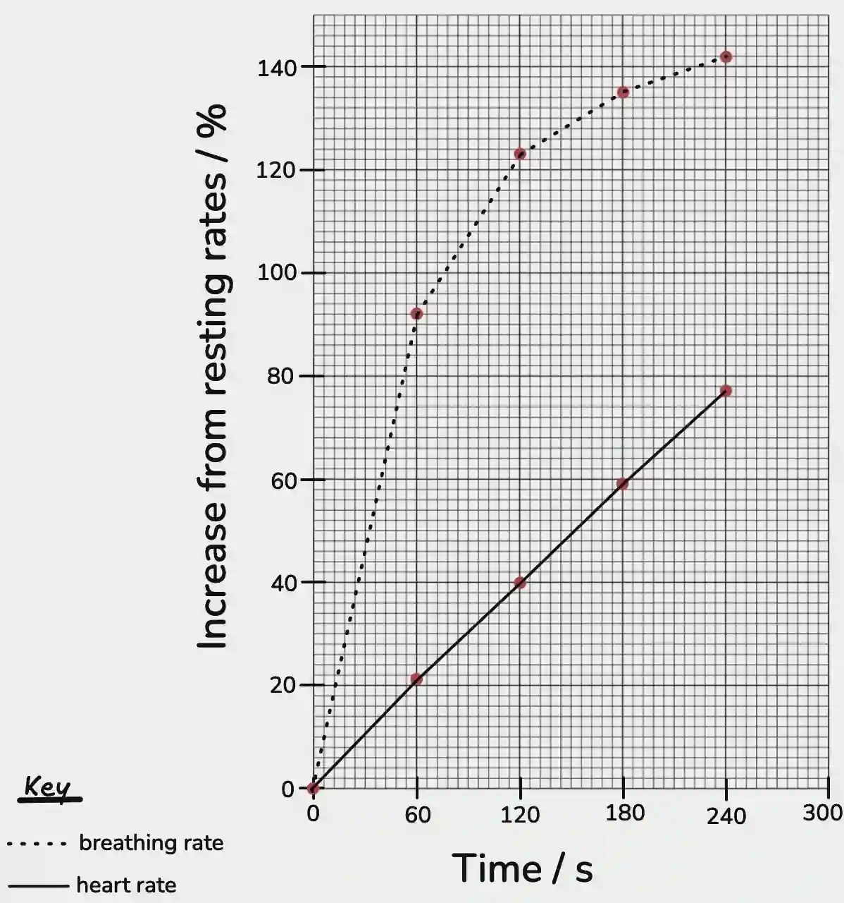

## Question 2

a.

i) Iodine Solution

ii) Benedict’s Solution

iii) A lilac colour

b.)

*(Write your variables in full sentences, not bullet points)*

### **Independent variable**

* Temperature of the fruit juice sample.

### **Dependent variable**

* Vitamin C concentration in the juice

### **Constant variables**

* Type and brand / source of fruit juice

* Volume of juice used for each titration

* Concentration of DCPIP solution

### **Method**

First, label five small flasks with the temperatures 5 °C, 20 °C, 40 °C, 60 °C, and 80 °C, and measure 20.0 cm³ of fruit juice into each one. Then, place the flasks into water baths set to their respective temperatures and allow the samples to equilibrate for 10 minutes so that each reaches the required temperature before titration. After heating, pipetting 10.0 cm³ of the juice into a conical flask. Next, fill a burette with DCPIP solution and titrate each juice sample by adding the DCPIP dropwise from the burette, swirling the conical flask after each drop. The end point is reached when a faint blue colour persists for at least 10 seconds, and the volume of DCPIP added is recorded from the burette. Finally, repeat the experiment for each temperature three times.

### **Safety Precautions**

* Wear safety goggles and gloves.

* Handle hot water and hot samples with heat-resistant gloves or tongs to avoid burns.

* Keep electrical equipment and water separate to avoid shocks.

c.

i)127.4 -132.4 = -5;

-5/132.4 x 100 = **3.8%**

ii) The volume of juice drank **OR** The sex of participants.

d.

i) the length of line PQ is 96 ± 1mm

96 ÷ 130 = **0.74mm**

ii) 

e.

i)

ii) As time passes while exercising the breathing and heart rate increases, but the rate of increase of the breathing rate is greater than the rate of increase of the heart rate.