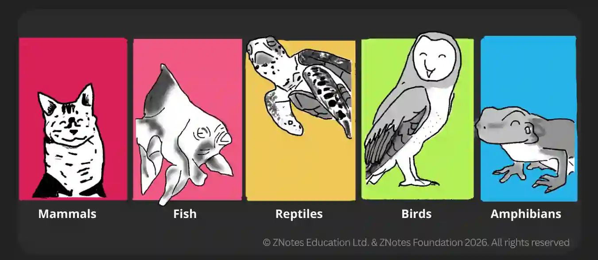

## Vertebrates

|Types of Vertebrates|Features|
|:---|:---|
|Mammals|Fur or hair on the skin, External ears (pinna), Internal fertilisation, Mammary Glands, give birth to live young of its kind|
|Reptiles|Thick, dry, scaly skin, Usually four legs, Internal fertilisation, Soft Shelled Eggs|
|Fish|Scaly skin, Streamlined body shape, External fertilisation, and their eggs have no hard shell, only a soft jelly coating.|
|Amphibians|Smooth, moist skin, External fertilisation, and soft eggs, Gills, & Lungs can live on land and water. Most have four legs.|
|Birds|Feathers on the body and scales on legs, Constant internal body temperature, Hard eggs, Internal fertilisation, birth through eggs|
