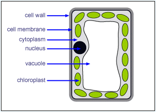
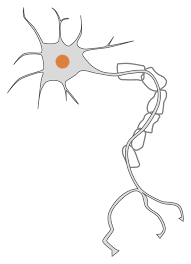
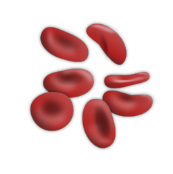

## Specialized cells

* Cilia- specialized epithelial cells with hairlike projections. They use sweeping to-and-fro moment to move items or also can have a sensory function

  

* Root hair cell- specialized extensions epidermal cells located at the tips of roots to maximise water and mineral absorption

  

* Palisade mesophyll cell- elongated epidermal cell on the surface level which contains a lot of chloroplasts to maximise photosynthesis

  

* Neurones- specialized cells of the nervous system responsible for sensory reception, processing and transmitting information

  

* Red blood cells- Biconcave shaped discs without nucleus or mitochondria to maximise oxygen consumption

  

* Sperm cell- Specialized for fertilization having a streamlined body and a flagellum for swimming, numerous mitochondria for energy production and acrosomes on the head which produce enzymes to penetrate the egg

  

* Egg cells- One of the largest cells in the body and also non-motile. Contains nutrients needed for initial development of zygote once it gets fertilized by the sperm.

  