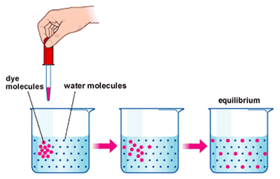

# Movement Into and Out of Cells

## Diffusion

**Diffusion:** Net movement of particles down the concentration gradient (high → low) as a result of their **random movement**.        

* At **Equilibrium,** the concentrations of molecules are equal.
* Energy for diffusion comes from the **kinetic energy of the random movement of molecules and ions.**
* The diffusion of gases and solutes is important as without it, molecules that are needed for life, (Such as glucose and oxygen for respiration) would not be able to get to the places they are required.
* Some substances move into and out of cells by diffusion through the cell membrane.

**Factors that influence diffusion (Passive Transport)**

* Concentration gradient
* Temperature
* Surface area to volume ratio
* Distance