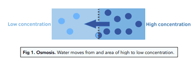
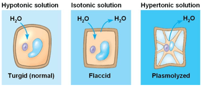
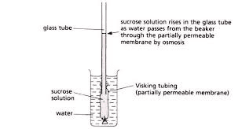

## Osmosis

* The role of water acts as **a solvent** in organisms to aid with **digestion, excretion, and transport.**
* Knowing the definition of **Diffusion, Osmosis and Active Transport is COMPULSORY**!
* The cell membrane is partially permeable, allowing small molecules (like water) through but not larger molecules.

**Osmosis**: Net movement of water molecules from a region of higher water potential (dilute solution) to a region of lower water potential (concentrated solution) through a **partially permeable membrane.**               

|Conc. of Solute (In-Cell)|Conc. of Solute (Outside-Cell)|Condition of the Cell|
|:---|:---|:---|
|Low|High|Cell Shrinks (**Flaccid**/Hypertonic)|
|Same|Same|No Change (Isotonic)|
|High|Low|**Turgid**/Hypotonic|

### **In Animals**

* Increasing solute concentration inside a cell can cause it to burst (**cell lysis**) because it has too much water and no cell wall.

### **In Plants**

* Increasing solute concentration inside the cell causes the cell to become **turgid**, and the vacuole fills up. The cell wall can withstand the **higher turgor pressure**.
* Decreasing solute concentration inside the cell causes the cell to become **flaccid**, losing water, and the vacuole to get smaller. The cell body shrinks, pulling away from the cell wall.
* Plants are supported by the water pressure inside the cells pressing outwards on the cell wall.
* Plasmolysis: the process in which a plant cell loses water due to osmosis, causing the cell membrane to shrink away from the cell wall.

### **Dialysis Tubing Experiment**

* **Dialysis Tubing** (or Visking tubing) is a non-living, **partially permeable** membrane made from cellulose.
* Pores are small enough to **prevent the passage of large molecules** (such as **sucrose**) but allow **smaller molecules** (such as **glucose and water**) to pass through by **diffusion** and **osmosis.**

