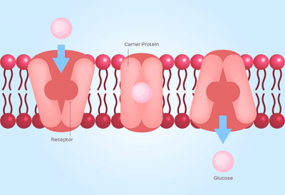

## Active Transport

**Active Transport**: The movement of particles through a cell membrane from a lower concentration region to a higher concentration region (i.e., against a concentration gradient) using energy from respiration (ATP)

* **Carrier Proteins or Protein Carriers** are also used during active transport.       
* It is embedded in the cell membrane, where it picks up specific molecules and moves them through the membrane against their concentration gradient.
* Active transport is needed when an organism wants to optimise the nutrients it can take up - **ion uptake by root hair cells**.
* Some particles are too large to cross a membrane by diffusion or active transport. A few very specialised cells have developed a method for taking up these particles; the particles are engulfed by the cell surface membrane flowing around them which is called Endocytosis. Endocytosis (called phagocytosis) is used by white blood cells to engulf pathogens.