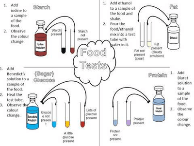

## Food Tests

| Test for: | Solution | Process | Positive Result | Negative Result |
|----|----|----|----|----|
| Reducing Sugars | Benedict Solution | Add Benedict solution into a beaker and Heat Up to 70-80°C | Brick Red | Blue |
| Starch | Iodine Solution | Add Iodine solution to the specimen | Blue-Black | Brown |
| Protein | Biuret Solution | Add Biuret solution to the sample | Purple/Violet | Blue |
| Fats (Physical test) | Ethanol | Add ethanol to the sample and shake with an equal volume of water. | Cloudy Emulsion | N/A |
| Vitamin C | DCPIP | Add DCPIP solution to the sample | Colourless | Blue |

 