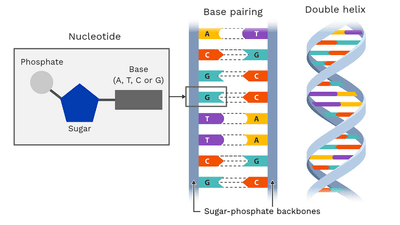

## Structure of a DNA

* Chromosomes are made of a molecule called **DNA**
* DNA is also called **deoxyribonucleic acid**.  
* Each chromosome is a very long molecule of tightly coiled DNA
* Two strands coiled together to form a **double helix**
* Each strand contains chemicals called **Bases**
* Names of DNA bases 
* A stands for Adenine
* T stands for Thymine
* C stands for Cytosine
* G stands for Guanine

  (NOTE THAT THE FULL NAMES OF THE BASES ARE NOT REQUIRED  FOR THE SYLLABUS)
* Cross-links between strands are formed by pairs of bases
* The bases always pair up in the same way, the base pairing rules are as follows:
  * **A and T**
  * **C and G**