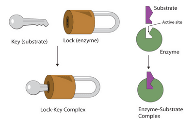

# Enzymes

## Enzymes

### **General Characteristics of an Enzyme**

* **Catalyst**: A substance that increases the rate of reaction and is not used up itself.
* **Enzymes**: **Specific** proteins involved in all metabolic reactions, functioning as biological catalysts.
* Enzyme **lowers the activation energy** needed for a reaction to take place.
* It is essential in all living organisms for sustaining life.
* Enzymes are unchanged and can be reused

### **Lock and Key Model (Hypothesis)**

* **Substrate:** the molecule(s) before they are made to react, **complementary** to the active site.
* **Product:** the molecule(s) that are made in a reaction

Different sequences of amino acids may lead to **varying shapes of protein molecules**, as these slight differences (temperature/pH) may be deferred in their function.