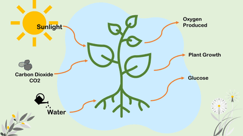

# Plant Nutrition

## Photosynthesis

**Photosynthesis:** the process by which plants manufacture carbohydrates from raw materials using energy from light.

$$
\text{Carbon Dioxide} + \text{Water} \xrightarrow {\text{light + chlorophyll}} \text{Glucose + Oxygen}
$$

$$
6CO_2 + 6H_2O\xrightarrow{light + chlorophyll}C_6H_{12}O_6+6O_2
$$

* Only **EXTENDED Students** must know the **Balanced Chemical Equation**
* The carbon dioxide diffuses through the open stomata of a plant leaf, and water is taken up through the roots.
* Chlorophyll is a **green pigment** that traps light energy and converts it into chemical energy to form carbohydrates and their subsequent storage.
* Glucose is used for respiration, energy storage, cellulose cell walls, and making proteins and sugars.

**Use and Storage of the Carbohydrates Made in Photosynthesis**

* starch as an energy store
* cellulose to build cell walls
* glucose used in respiration to provide energy
* sucrose for transport in the phloem