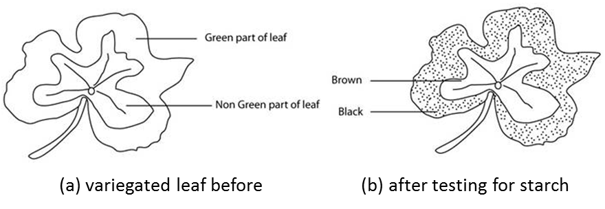

## Investigation of Chlorophyll

* Take a potted plant with variegated (green and white) leaves.
* De-starch the plant by keeping it in complete darkness for about 48 hours.
* Expose the plant to sunlight for a few days.
* Leaf boiled in water for 2 minutes to break down cell walls, denature enzymes and allow for easier penetration by ethanol.
* Warmed in ethanol until the leaf is colourless to extract chlorophyll, which would mask the observation
* Dipped into the water briefly: to help soften the leaf
* The leaf is placed on a white tile, and iodine is added. If starch is present, the colour will be blue-black; if absent, it will remain brown.

 